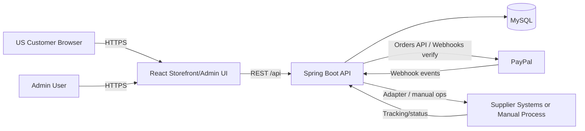
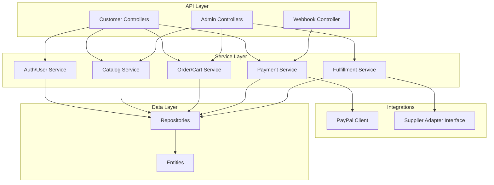

# 05 — System Architecture

## 1. Overview
Fetch uses a **React (JavaScript, JSX)** single-page application frontend, a **Spring Boot (Java, Maven)** REST API backend, and **MySQL** for persistent data. Payments use **PayPal** (Orders API + webhooks). Supplier fulfillment is handled via an **adapter layer** with manual fallback until verified supplier APIs are available.

## 2. Frontend architecture
- **Framework:** React.js + JSX (no TypeScript).
- **Styling:** Tailwind CSS with design tokens.
- **Icons:** Lucide React.
- **Routing:** React Router.
- **Server state:** TanStack Query where appropriate (catalog, cart, orders, admin data).
- **HTTP:** Axios (or equivalent) with interceptors for auth/error handling.
- **Structure:** Modular separation of pages, layouts, components, hooks, services/API clients, auth utilities, validation, constants. Admin and storefront may share primitives but have distinct route guards/layouts.

### Frontend responsibilities
- Render UI/UX per design system.
- Collect/validate input (client-side) but **never** be the source of truth for totals/payment status.
- Call backend APIs; handle loading/error/empty states.

## 3. Backend architecture
- **Framework:** Spring Boot, Maven.
- **Layers:** Controller → Service → Repository; DTOs for API boundaries; mappers (manual or MapStruct later if adopted — MVP can use manual mapping to limit dependencies); entities for persistence.
- **Cross-cutting:** Bean Validation, global exception handling, Spring Security, configuration properties, logging/audit.
- **Integration style:** Interfaces for payment/supplier providers to allow sandbox/manual implementations.

### Backend responsibilities
- Authoritative pricing/totals calculation at checkout/payment creation.
- Order state machine enforcement.
- PayPal order creation/capture and webhook verification.
- Idempotent processing for payments/webhooks/supplier submissions.
- RBAC for customer vs. admin endpoints.

## 4. Database architecture
- **DBMS:** MySQL (InnoDB).
- **Approach:** Normalized core commerce tables + targeted snapshot/audit tables (`order_items` snapshots, `payments`, `webhook_events`).
- **Migrations:** Planned tool (e.g., Flyway/Liquibase) in implementation phase — **no migrations created now**.
- **Indexing:** Foreign keys, lookup fields (email, slugs, SKUs, PayPal IDs, order numbers, status+created_at).

## 5. Authentication and authorization
- Customers: register/login; password hashing; token/session strategy selected in Phase 2 (e.g., JWT access + refresh or secure server session) — decision recorded; implement consistently.
- Admin: separate role claims; protected `/api/admin/**` and `/admin` routes.
- **CSRF/CORS/rate limiting:** per `10_SECURITY_PLAN.md`.

## 6. Payment integration
- Frontend obtains approval flow via PayPal JS SDK/buttons **configured with client ID from backend-configured public settings only if safe**; sensitive operations (create/capture, webhook verify) are **backend-only**.
- Internal order created/referenced before capture; capture verified server-side; webhooks reconcile async events.

## 7. Supplier integration
- `SupplierFulfillmentService` (conceptual) with adapters: `ManualFulfillmentAdapter` (MVP default) and future `ApiFulfillmentAdapter` per supplier.
- Product/sync/tracking capabilities feature-detected per supplier; unsupported features fall back to admin workflows.

## 8. API communication
- JSON over HTTPS REST.
- Versioning strategy (e.g., `/api/v1`) decided at implementation start.
- Consistent error envelope (code, message, field errors, correlation ID).

## 9. Deployment architecture (planned)
- **Frontend:** static hosting/CDN-capable platform (e.g., Vercel/Netlify/Cloudflare Pages or S3+CDN) with HTTPS and environment-based API base URL.
- **Backend:** containerized Spring Boot (e.g., AWS ECS/Fargate, Render, Railway, Fly.io, or VPS) behind HTTPS load balancer/reverse proxy.
- **Database:** managed MySQL (e.g., AWS RDS, PlanetScale MySQL-compatible considerations evaluated carefully, DigitalOcean Managed MySQL) with backups, private networking.
- **Secrets:** platform secret manager/env vars; never in repo or frontend bundle.
- **Domain/DNS:** custom domain, TLS certs, separate subdomains if desired (e.g., `www` + `api`).

## 10. Architecture diagrams (Mermaid)

### 10.1 High-level system context


### 10.2 Checkout and payment sequence (simplified)
```mermaid
sequenceDiagram
  participant C as Customer (React)
  participant B as Spring Boot
  participant M as MySQL
  participant P as PayPal

  C->>B: POST /checkout/validate (cart/address)
  B->>M: Read products/prices; create/update pending order snapshot
  B-->>C: Order summary + internal order ref
  C->>B: POST /payments/paypal/create
  B->>P: Create PayPal Order (server-side)
  P-->>B: PayPal order id
  B->>M: Store payment intent/pending
  B-->>C: PayPal order id / approval data
  C->>P: Buyer approves in PayPal UI
  C->>B: POST /payments/paypal/capture (internal ref)
  B->>P: Capture/verify order
  P-->>B: Capture result
  B->>M: Transaction: mark paid, record payment, update order state
  B-->>C: Confirmed order (no secrets)
  P--)B: Webhook (async, duplicate possible)
  B->>B: Verify signature + idempotency
  B->>M: Reconcile state if needed
```

### 10.3 Backend module view


## 11. Key architectural decisions
- **Monolith-first backend:** simpler operations for MVP; modular packages enable later extraction if needed.
- **Server-side payment truth:** prevents frontend spoofing.
- **Adapter pattern for suppliers:** isolates unknown/variable third-party capabilities.
- **Snapshots for orders:** protects historical accuracy against catalog/price changes.
- **Configurable branding/integrations:** supports “Fetch” rename and environment promotion.
