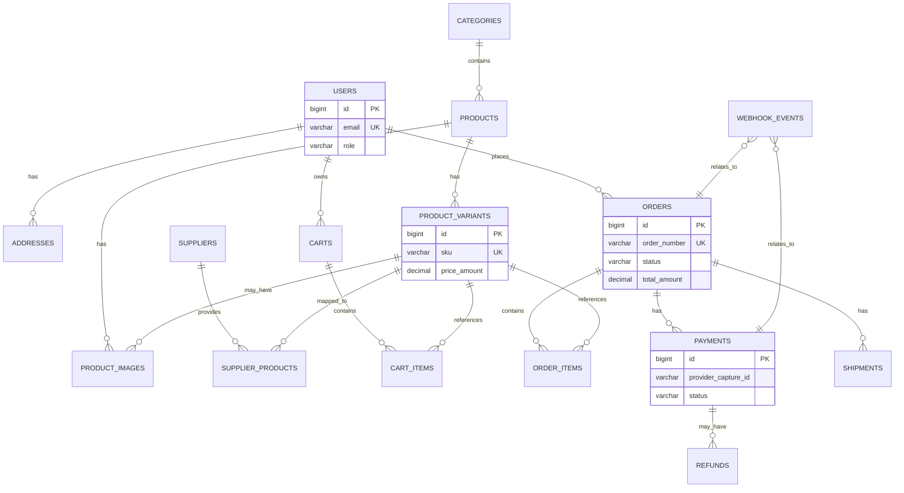

# 06 — Database Design (MySQL)

## 1. Design goals
- Practical, normalized core schema for an ecommerce MVP with room to grow.
- **Order/payment integrity** via snapshots, constraints, and audit tables.
- Avoid unnecessary tables until a feature requires them.
- Support dropshipping realities (supplier mappings, fulfillment/tracking, manual fallbacks).

## 2. Conventions
- Engine: **InnoDB**, charset `utf8mb4`.
- Primary keys: `BIGINT` auto-increment (or UUID strategy if chosen later; document if changed).
- Money: `DECIMAL(12,2)` for amounts; store currency code (`CHAR(3)`, e.g., USD).
- Timestamps: `created_at`, `updated_at` (`DATETIME(3)`/`TIMESTAMP` per team standard); soft delete `deleted_at` only where truly needed.
- Statuses: `VARCHAR` enums-in-app or MySQL `ENUM` used cautiously (app-level enums preferred for evolvability).

## 3. MVP table assessment (from candidate list)
| Table | MVP? | Rationale |
|---|---|---|
| `users` | Yes | Customer + admin identities (role-separated). |
| `roles` | Maybe (simplify) | MVP can use `users.role` enum/column; separate `roles` table if multi-role/RBAC grows. |
| `addresses` | Yes | Shipping/billing and saved addresses. |
| `products` | Yes | Catalog core. |
| `product_variants` | Yes | Size/color/sku/price overrides common in accessories. |
| `categories` | Yes | Collections/navigation. |
| `product_images` | Yes | Gallery ordering. |
| `suppliers` | Yes (light) | Track source even if manual; needed for mappings. |
| `supplier_products` | Yes (light) | Map internal variant/product to supplier SKU/URL/cost. |
| `carts` | Yes | Authenticated carts; guest cart may be session-based or separate strategy. |
| `cart_items` | Yes | Line items. |
| `orders` | Yes | Core. |
| `order_items` | Yes | Snapshot of purchased items. |
| `payments` | Yes | PayPal attempts/captures/refund refs. |
| `refunds` | MVP-light | Can start as columns/status + payment records; separate table if multiple partial refunds/ops needed. |
| `shipments` | Yes (or fold into orders) | Tracking/carrier; separate table supports multiple shipments later. |
| `reviews` | Later | **No fake reviews**; table can be designed but not populated with fabricated content. |
| `coupons` | Post-MVP | Design later unless simple promo required. |
| `coupon_usage` | Post-MVP | Depends on coupons. |
| `wishlists` / `wishlist_items` | Post-MVP | Nice-to-have. |
| `inventory_snapshots` | Optional MVP | Useful for dropshipping availability audits; can be minimal or deferred. |
| `webhook_events` | Yes | Idempotency/audit for PayPal (and future suppliers). |

**MVP recommendation:** implement `users`, `addresses`, `categories`, `products`, `product_variants`, `product_images`, `suppliers`, `supplier_products`, `carts`, `cart_items`, `orders`, `order_items`, `payments`, `shipments` (or tracking fields on orders initially), `webhook_events`. Defer `reviews`, `coupons*`, `wishlists*` until needed; keep schema extensible.

## 4. Core tables (proposed)

### 4.1 `users`
| Column | Type | Notes |
|---|---|---|
| id | BIGINT PK | |
| email | VARCHAR(255) UNIQUE NOT NULL | login/idempotent lookup |
| password_hash | VARCHAR(255) NOT NULL | never plaintext |
| first_name, last_name | VARCHAR(100) | |
| phone | VARCHAR(30) NULL | optional |
| role | VARCHAR(30) NOT NULL | `CUSTOMER`, `ADMIN`, `STAFF` |
| status | VARCHAR(30) NOT NULL | active/disabled |
| email_verified_at | DATETIME(3) NULL | future |
| created_at, updated_at | DATETIME(3) | |

### 4.2 `addresses`
| Column | Type | Notes |
|---|---|---|
| id | BIGINT PK | |
| user_id | BIGINT FK -> users.id | |
| type | VARCHAR(20) | shipping/billing |
| full_name, line1, line2, city, state, postal_code, country_code | VARCHARs | US-focused validation in app |
| phone | VARCHAR(30) NULL | |
| is_default | BOOLEAN | |
| created_at, updated_at | DATETIME(3) | |

### 4.3 `categories`
| Column | Type | Notes |
|---|---|---|
| id | BIGINT PK | |
| parent_id | BIGINT NULL FK | optional hierarchy |
| name | VARCHAR(120) NOT NULL | |
| slug | VARCHAR(140) UNIQUE NOT NULL | URL |
| description | TEXT NULL | |
| is_active | BOOLEAN | |
| sort_order | INT | |
| created_at, updated_at | DATETIME(3) | |

### 4.4 `products`
| Column | Type | Notes |
|---|---|---|
| id | BIGINT PK | |
| category_id | BIGINT FK -> categories.id | primary category (MVP) |
| name | VARCHAR(200) NOT NULL | |
| slug | VARCHAR(220) UNIQUE NOT NULL | |
| description | MEDIUMTEXT NULL | |
| base_price_amount | DECIMAL(12,2) NOT NULL | display/default |
| currency | CHAR(3) NOT NULL | USD default |
| status | VARCHAR(30) NOT NULL | draft/active/archived |
| seo_title, seo_description | VARCHAR/TEXT NULL | |
| created_at, updated_at | DATETIME(3) | |

### 4.5 `product_variants`
| Column | Type | Notes |
|---|---|---|
| id | BIGINT PK | |
| product_id | BIGINT FK | |
| sku | VARCHAR(100) UNIQUE NOT NULL | internal SKU |
| title | VARCHAR(150) | e.g., "Lavender / M" |
| option_values_json | JSON NULL | flexible attrs (size/color) |
| price_amount | DECIMAL(12,2) NOT NULL | variant price |
| currency | CHAR(3) | |
| weight_grams | INT NULL | shipping future |
| is_active | BOOLEAN | |
| created_at, updated_at | DATETIME(3) | |

### 4.6 `product_images`
| Column | Type | Notes |
|---|---|---|
| id | BIGINT PK | |
| product_id | BIGINT FK | |
| variant_id | BIGINT NULL FK | optional |
| url | VARCHAR(1024) NOT NULL | CDN/object storage URL |
| alt_text | VARCHAR(255) | accessibility |
| sort_order | INT | |
| created_at | DATETIME(3) | |

### 4.7 `suppliers` / `supplier_products`
**suppliers:** id, name, code UNIQUE, contact/status metadata, api_mode (`manual`/`api`), created/updated.
**supplier_products:** id, supplier_id FK, product_variant_id FK, supplier_sku, supplier_product_ref, cost_amount/currency NULL, shipping_notes, last_synced_at NULL, is_active. Unique constraint on (supplier_id, supplier_sku) where applicable.

### 4.8 `carts` / `cart_items`
**carts:** id, user_id NULL FK (guest strategy may use token table later), status, currency, created/updated, expires_at NULL.
**cart_items:** id, cart_id FK, product_variant_id FK, quantity INT CHECK > 0, unit_price_snapshot DECIMAL(12,2) (revalidated), created/updated. Unique (cart_id, product_variant_id).

### 4.9 `orders` / `order_items`
**orders:** id, order_number UNIQUE, user_id NULL FK, status, currency, subtotal_amount, shipping_amount, tax_amount, discount_amount, total_amount, customer_email, shipping_address_snapshot JSON, billing_address_snapshot JSON NULL, notes_internal TEXT NULL, placed_at, paid_at NULL, created/updated. Index (status, created_at), (user_id, created_at).
**order_items:** id, order_id FK, product_variant_id FK (nullable if deleted later? prefer keep FK + snapshot fields), product_name_snapshot, variant_title_snapshot, sku_snapshot, unit_price_amount, quantity, line_total_amount. **Snapshots are mandatory**.

### 4.10 `payments`
| Column | Type | Notes |
|---|---|---|
| id | BIGINT PK | |
| order_id | BIGINT FK | |
| provider | VARCHAR(30) | `PAYPAL` |
| provider_order_id | VARCHAR(128) NULL | PayPal order ID |
| provider_capture_id | VARCHAR(128) NULL | capture ID |
| status | VARCHAR(40) | pending/captured/failed/refunded/... |
| amount, currency | DECIMAL/CHAR | |
| idempotency_key | VARCHAR(128) NULL UNIQUE | where used |
| raw_response_redacted | JSON/TEXT NULL | no secrets |
| created_at, updated_at | DATETIME(3) | |

### 4.11 `shipments` (MVP tracking)
id, order_id FK, supplier_id NULL FK, carrier VARCHAR(80), tracking_number VARCHAR(120), tracking_url VARCHAR(1024), status VARCHAR(40), shipped_at, delivered_at, created/updated.

### 4.12 `webhook_events`
id, provider, event_id UNIQUE (provider event ID), event_type, order_id NULL FK, payment_id NULL FK, payload_hash, received_at, processed_at NULL, process_status, error_message NULL. **Critical for idempotency**.

### 4.13 `refunds` (if separated in MVP)
id, payment_id FK, order_id FK, provider_refund_id, amount, currency, status, reason, created_at. Alternatively track minimal refund state on `payments`/`orders` in earliest MVP and add table when partial/multiple refunds are operational.

## 5. ER diagram (Mermaid)

## 6. Indexing and constraints (summary)
- Unique: `users.email`, `categories.slug`, `products.slug`, `product_variants.sku`, `orders.order_number`, `webhook_events(provider,event_id)`, PayPal IDs where stable.
- FKs with appropriate `ON DELETE` behavior (prefer restrict; use soft/archive patterns over cascading deletes for commerce history).
- Index hot paths: catalog filters/slugs, cart lookup, orders by user/status/date, payments by order/provider IDs.

## 7. Important business rules
- **Never delete** financial/order history rows required for audit; use status/archival.
- **Order items store snapshots**; product/variant edits do not rewrite past orders.
- **Payment state transitions** are guarded; duplicate webhooks must not double-capture/refund.
- **Inventory** is not warehouse stock initially; availability is supplier-informed/manual and must be communicated carefully.
- **PII** (addresses, emails) access is limited and logged appropriately for admin actions where required.
