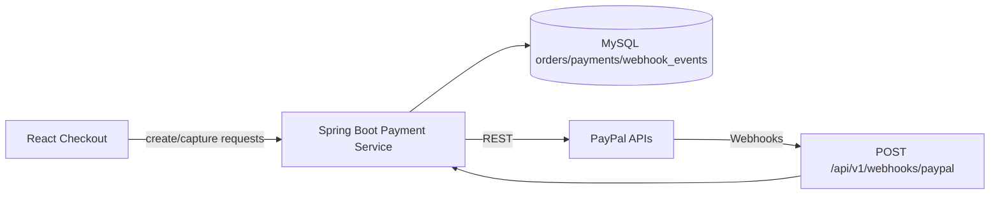

# 08 — PayPal Payment Integration

## 1. Goals
- Accept PayPal payments from US customers for Fetch orders.
- Keep **payment truth on the backend** (Spring Boot).
- Support sandbox testing first; production only after business/account verification.
- Handle webhooks, duplicates, failures, and refunds safely.

## 2. Scope and constraints
- **Provider:** PayPal Checkout / Orders API v2 (implementation details confirmed at dev time against current PayPal docs).
- **Currency:** USD for MVP (confirm business needs).
- **No secrets in frontend:** client ID exposure rules follow PayPal’s model; **secret, webhook ID/verification secrets, and capture logic remain server-side**.
- **Production approval not assumed.**

## 3. Architecture

## 4. Order creation flow
1. Customer completes checkout form; frontend sends address/cart context.
2. Backend **revalidates** cart items, prices, availability signals, and totals.
3. Backend creates/updates an **internal order** in `pending_payment` (or equivalent) with **snapshotted** line items and totals + `order_number`.
4. Backend calls PayPal **Create Order** with amount/currency/reference (custom_id/invoice_id strategy) mapped to internal order.
5. Backend stores `provider_order_id` and pending payment record; returns only what frontend needs to render approval.

## 5. Payment approval
- Buyer approves via PayPal UI (JS SDK/buttons or redirect flow — choose one consistent UX).
- Frontend notifies backend to **capture**; frontend must not mark order paid locally as final truth.

## 6. Payment capture and verification
1. Backend calls PayPal **Capture Order** (or verifies capture status) for the matching internal order.
2. On success, backend runs a **transaction**: update payment to captured, set order `paid` (with `paid_at`), record capture IDs, clear/convert cart as designed.
3. On failure/decline, record failure, keep order `payment_failed`/pending rules, return actionable error.
4. Backend enforces **state guards** (cannot capture an already captured/fulfilled-incompatible state without explicit rules).

## 7. Webhook verification and processing
- Endpoint: `POST /api/v1/webhooks/paypal`.
- **Verify authenticity** using PayPal webhook signature verification (transmission ID, timestamp, cert URL, auth algo, transmission sig) per current PayPal requirements — implementation must use official/recommended approach.
- **Idempotency:** store `event_id`; if already processed, return 200 without reapplying side effects.
- **Reconciliation:** handle events such as payment capture completed/denied, refunds reversed/completed (exact event set finalized during implementation). Webhooks may arrive **before or after** capture response — design for both.
- **Reliability:** respond quickly (2xx) after durable receipt; process via async worker/queue pattern if needed later (MVP may process inline with care).

## 8. Refund processing
- Admin initiates refund with reason/amount (full/partial as supported).
- Backend calls PayPal refund API against capture; records `refunds`/payment status updates.
- Update order status per business rules (`refunded`/`partially_refunded` if modeled).
- **Constraint:** refunds depend on capture state and PayPal account capabilities.

## 9. Payment status management
Suggested internal mapping (align to PayPal states during implementation):
- `PENDING` → internal payment pending / order pending_payment
- `COMPLETED/CAPTURED` → paid
- `FAILED/DECLINED` → payment_failed
- `REFUNDED/PARTIALLY_REFUNDED` → refunded states

All transitions logged with correlation/payment IDs.

## 10. Security considerations
- HTTPS everywhere; webhook endpoint publicly reachable but verified.
- Secrets in env/secret manager: `PAYPAL_CLIENT_ID` (as needed), `PAYPAL_CLIENT_SECRET`, `PAYPAL_WEBHOOK_ID`, mode (sandbox/live).
- Least-privilege logging (mask PII; never log full secrets).
- Validate amounts/currency against internal order on capture.
- Protect against replay/duplicate with idempotency keys and event IDs.
- Admin refund endpoints RBAC + audit trail.

## 11. Sandbox testing
- Use PayPal Developer sandbox accounts (business + personal buyer).
- Test cases: happy path, cancelled approval, capture failure, duplicate webhook delivery, out-of-order events, partial refund (if supported), amount mismatch rejection.
- Automate where possible in integration tests with mocked/sandbox configs.

## 12. Production requirements (checklist before go-live)
- Verified PayPal business account and live credentials.
- Webhook configured for production URL and verified.
- Policies (shipping/returns/privacy/terms) published and consistent with operations.
- TLS, domain, monitoring, alerting, and backup/restore tested.
- Dispute/chargeback handling process defined.
- Compliance/legal review as applicable (India operator/US customers).

## 13. Open questions
- PayPal account type/approval timeline and supported features (refunds, disputes tools).
- Whether to use PayPal JS SDK buttons only or include additional PayPal funding sources — UX/legal/tax implications.
- Invoice/reference formatting requirements for accounting.
